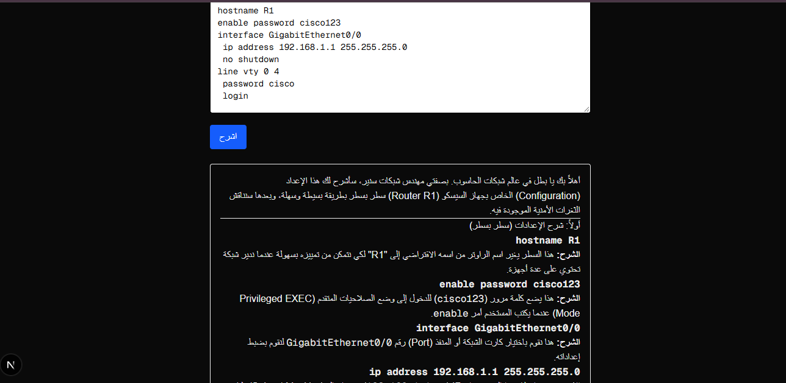

# شارح إعدادات الشبكة

أداة تشرح config الراوترات والسويتشات بالعربي وتكشف المشاكل الأمنية، باستخدام Gemini API.

## التقنيات

- Next.js + TypeScript
- Tailwind CSS
- Gemini API
- react-markdown

## طريقة التشغيل

1. npm install
2. سوي ملف .env.local واكتبي فيه: GEMINI_API_KEY=مفتاحك
3. npm run dev
4. افتحي localhost:3000

## ملاحظات

- الموديل ممكن يغلط، فراجعي الشرح التقني.
- لا تلصقين config حقيقي فيه باسوردات.

## المرحلة الثانية: RAG (اسألي المستند)

صفحة `/ask` تجاوب من المستندية: RAG (اسألي المستند)بدل معلومات الموديل.

طريقة العمل:

1. تقطيع المستند لقطع صغيرة.
2. تحويل كل قطعة لأرقام (embeddings) بموديل gemini-embedding-001.
3. وقت السؤال نجيب أقرب 3 قطع بالمعنى (cosine similarity).
4. نرسل القطع مع السؤال لـ Gemini ونطلب منه يجاوب منها فقط.

إذا الجواب مو بالمستند، يقول إنه مو موجود.

## المرحلة الثالثة: Agent (مساعد مهندس الشبكات)

صفحة `/agent` فيها مساعد يختار الأدوات بنفسه وينفذها، مو بس يجاوب.

الأدوات:
-يها مساعد يختار الأد يحسب الشبكة والـ Broadcast وعدد الأجهزة بدقة.

- صفحة `/agent` فيها مساعد يفحص الـ config ويطلع المشاكل الأمنية.
  -شبكات)

صفحة `/ يبحث بالمستند (RAG).

طريقة العمل:

1. نرسل الطلب مع قائمة الأدوات لـ Gemini.
2. إذا طلب أداة، ينفذها السيرفر ونرجع له النتيجة.
3. نكرر لين يجاوب بنص نهائي، بحد أقصى 5 جولات.
4. الصفحة تعرض الأدوات اللي استخدمها مع نتائجها.

## Stage 4: Production readiness

- API protection: 5 requests per minute per IP, input length validation
- Metrics: logs request time and token usage
- Hybrid design: code finds the security issues, the model explains the config
- Cache: the same config returns the same answer
- Evals: run npm run eval

Results: about 290 tokens and 2 s per request, down from 1436 tokens and 10 s.
